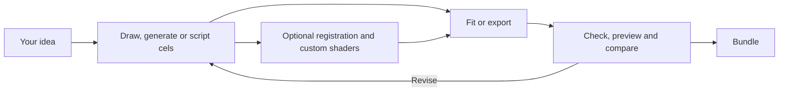

# Emoji Forge

Emoji Forge gives you and your agent tools to make and share custom emoji, stickers and reactions. Bring drawings or generate cels, write your own GLSL passes, or animate with a Python hook. Forge handles registration, export budgets, previews, and comparisons. You and your agent decide what to make.


[Still preview](examples/demo/preview.png) · [Example ZIP](examples/demo/pack.zip) · [Example source](examples/build.py)

## Install

Run this from your project with Node.js 22.20 or later.

```sh
npx skills add ppazosp/emoji-forge
```

Select your agent when prompted. For a targeted install, use `-a claude-code`, `-a codex`, or `-a cursor`. Add `-y` to skip prompts or `-g` for a user-level install. The installer uses the canonical project directory `.agents/skills/emoji-forge` for Codex and Cursor, and adds a Claude Code entry under `.claude/skills/emoji-forge` when selected. Other supported agents include OpenCode, Gemini CLI, and GitHub Copilot. [CLI commands and flags](https://github.com/vercel-labs/skills/blob/main/docs/commands.md) · [Agent directories](https://github.com/vercel-labs/skills/blob/main/src/agents.ts)

### Claude Code marketplace

In Claude Code, register the marketplace and install the plugin.

```
/plugin marketplace add ppazosp/emoji-forge
/plugin install emoji-forge@emoji-forge
```

Invoke the plugin skill as `/emoji-forge:emoji-forge`. Claude Code 2.1.275 or later also supports `/plugin install emoji-forge --marketplace ppazosp/emoji-forge` in one step. [Claude Code marketplace docs](https://code.claude.com/docs/en/plugin-marketplaces)

### Manual copy

Clone the repo or download the source from [Releases](https://github.com/ppazosp/emoji-forge/releases). Copy the full [`skills/emoji-forge/`](skills/emoji-forge/) directory into your agent's project skills directory. For example, from a fresh checkout:

```sh
mkdir -p /path/to/project/.agents/skills
cp -R skills/emoji-forge /path/to/project/.agents/skills/
```

Use `.agents/skills` for Codex or Cursor and `.claude/skills` for Claude Code. The directory you copy includes the skill, references, scripts, shaders, Python project, and sample assets. [Agent Skills specification](https://agentskills.io/specification) · [Codex skill locations](https://developers.openai.com/codex/skills/) · [Claude Code skill locations](https://code.claude.com/docs/en/skills)

### Run Forge

Install [uv](https://docs.astral.sh/uv/) for the CLI. From the installed skill directory, run `uv run forge --help`. From another directory, use `uv run --project SKILL_DIR forge --help` with the path to the skill. In a clone, `SKILL_DIR` is `skills/emoji-forge`.

Raster commands use Pillow. Add `--extra gpu` to the `uv run` command for ModernGL. For WebGL, add `--extra webgl` and use installed Chrome with `--channel chrome`, or install Chromium with `uv run --extra webgl playwright install chromium` from the skill directory.

## Five-command loop

Run these commands from the skill directory. This example uses a folder of cels and a shader you write. A pack manifest is useful when you want to reuse the same steps across several emoji.

```sh
uv run forge new my-emoji --no-manifest
# Sketch ideas together, draw cels into my-emoji/cels, and write my-emoji/glow.frag.
uv run --extra gpu forge all my-emoji/cels build/draft --preset slack --effect my-emoji/glow.frag --draft
uv run forge snapshot build/draft build/review
uv run --extra gpu forge all my-emoji/cels build/final --preset slack --effect my-emoji/glow.frag --json
uv run forge compare build/draft build/final build/comparison
```

The style and storyboard files are conversation prompts. Use them for sketches, links or whatever helps you iterate. Run any command on its own. For example, `forge fit cels/ wave.gif --preset slack` takes a folder and returns a sized GIF. The [tool reference](skills/emoji-forge/references/workflow.md) covers timing, optional manifests, Python hooks and all commands.

## How the tools fit together



## Examples

- [Sprout pack](examples/demo/) shows three animated reactions and one still. Rebuild it from a checkout with `uv run --project skills/emoji-forge --extra gpu python examples/build.py build/example`.
- [Custom animation and shader chain](skills/emoji-forge/assets/lantern/) uses a Python function to draw the sequence and two original GLSL passes. See the [shader walkthrough](skills/emoji-forge/references/shaders.md) to write your own.

`forge all` can build multiple emoji in parallel and reuse cached renders. Add `--draft` to try an idea quickly and `--json` to read results programmatically. The [Slack reference](skills/emoji-forge/references/slack.md) describes its export targets. The generic preset and independent commands also work without Slack.

From the checkout root, run `uv run --project skills/emoji-forge --extra gpu --extra test pytest -q` for the local test suite. To include WebGL, install Chrome and run with `--extra webgl` and `FORGE_TEST_CHROME=chrome`.

## Authors

- [Pablo Pazos](https://github.com/ppazosp)
- [Jorge Hermo](https://github.com/jorgehermo9) · [@jorgehermo9 on X](https://x.com/jorgehermo9)

[MIT license](LICENSE)
