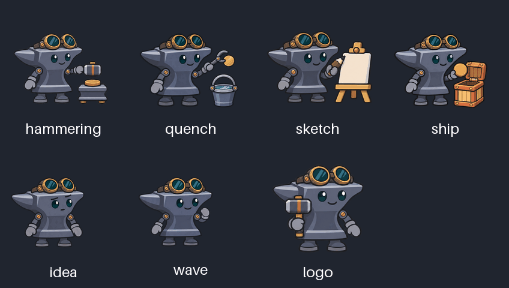

# Emoji Forge



Turn an idea, a mascot, or your own artwork into a custom emoji pack with your AI agent.

## What you can make

- Create still emoji, animated reactions, and stickers in your own style.
- Add GPU-rendered fire, glow, laser beams, glitches, or portals. Bring your own shader for a custom effect.
- Download Slack-ready files plus larger and smaller versions at 64, 128, 256, and 512 px.
- Share one preview of the whole pack and grab every emoji in a ZIP.

## Examples gallery

**Tavvik** — “Make a little anvil who forges emoji.” The pack above includes hammering, quenching, and shipping reactions. [Download the pack](examples/mascot/tavvik.zip) · [Model sheets, animatic, and lineup](examples/mascot/)

| Paper bird | Lantern |
| --- | --- |
|  |  |
| “Make a folded paper bird wave hello.” [Example](skills/emoji-forge/assets/threaded/) | “Make a lantern with a pulse of warm light.” [Shader example](skills/emoji-forge/assets/lantern/) |

See also the [Sprout reaction pack](examples/demo/).

## Install

```sh
npx skills add ppazosp/emoji-forge
```

Select your agent when prompted. Forge runs with uv. [Get uv](https://docs.astral.sh/uv/)

**Claude Code marketplace**

```
/plugin marketplace add ppazosp/emoji-forge
/plugin install emoji-forge@emoji-forge
```

**Manual copy.** Copy the full [skill directory](skills/emoji-forge/) into your project's `.agents/skills/` for Codex or Cursor, or `.claude/skills/` for Claude Code. [Setup details](skills/emoji-forge/references/setup.md)

## Usage

Select Emoji Forge in your agent and tell it what you want. In Claude Code, use `/emoji-forge` for a skills install or `/emoji-forge:emoji-forge` for the marketplace plugin.

> Make me six animated Slack emoji of our mascot using the attached reference. Include a wave, a cheer, and a surprised reaction.

> Make a looping portal sticker with a violet glow, plus a still PNG for announcements.

For an idea-to-pack run, ask your agent to use `forge make`. [Emoji Forge skill](skills/emoji-forge/SKILL.md) · [CLI and workflow reference](skills/emoji-forge/references/workflow.md)

## Authors and license

[Pablo Pazos](https://github.com/ppazosp) and [Jorge Hermo](https://github.com/jorgehermo9) ([`@jorgehermo9` on X](https://x.com/jorgehermo9)). [MIT license](LICENSE)
