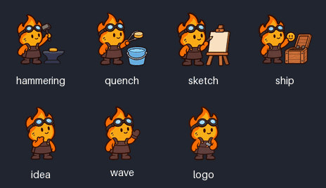
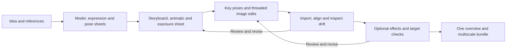
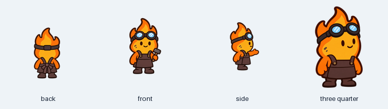
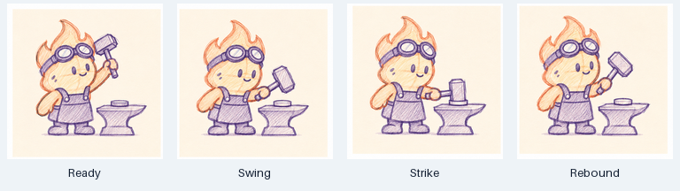
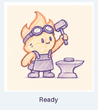

# Emoji Forge

Emoji Forge gives you and your agent tools to make and share custom emoji, stickers and reactions. Draw a consistent cel sequence with your agent’s native image tool, then add any effects you want. You can also bring your own artwork or use a Python hook. Forge handles registration, export budgets, previews, and comparisons. You and your agent decide what to make.



[Ember production files](examples/mascot/) · [Download the Ember pack](examples/mascot/ember.zip)

## Install

Run this from your project with Node.js 22.20 or later.

```sh
npx skills add ppazosp/emoji-forge
```

Select your agent when prompted. For a targeted install, use `-a claude-code`, `-a codex`, or `-a cursor`. Add `-y` to skip prompts or `-g` for a user-level install. The installer uses the canonical project directory `.agents/skills/emoji-forge` for Codex and Cursor, and adds a Claude Code entry under `.claude/skills/emoji-forge` when selected. Other supported agents include OpenCode, Gemini CLI, and GitHub Copilot. [CLI commands and flags](https://github.com/vercel-labs/skills/blob/main/docs/commands.md) · [Agent directories](https://github.com/vercel-labs/skills/blob/main/src/agents.ts)

### Claude Code marketplace

In Claude Code, register the marketplace and install the plugin.

```
/plugin marketplace add ppazosp/emoji-forge
/plugin install emoji-forge@emoji-forge
```

Invoke the plugin skill as `/emoji-forge:emoji-forge`. Claude Code 2.1.275 or later also supports `/plugin install emoji-forge --marketplace ppazosp/emoji-forge` in one step. [Claude Code marketplace docs](https://code.claude.com/docs/en/plugin-marketplaces)

### Manual copy

Clone the repo or download the source from [Releases](https://github.com/ppazosp/emoji-forge/releases). Copy the full [`skills/emoji-forge/`](skills/emoji-forge/) directory into your agent's project skills directory. For example, from a fresh checkout:

```sh
mkdir -p /path/to/project/.agents/skills
cp -R skills/emoji-forge /path/to/project/.agents/skills/
```

Use `.agents/skills` for Codex or Cursor and `.claude/skills` for Claude Code. The directory you copy includes the skill, references, scripts, shaders, Python project, and sample assets. [Agent Skills specification](https://agentskills.io/specification) · [Codex skill locations](https://developers.openai.com/codex/skills/) · [Claude Code skill locations](https://code.claude.com/docs/en/skills)

### Run Forge

Install [uv](https://docs.astral.sh/uv/) for the CLI. From the installed skill directory, run `uv run forge --help`. From another directory, use `uv run --project SKILL_DIR forge --help` with the path to the skill. In a clone, `SKILL_DIR` is `skills/emoji-forge`.

Raster commands use Pillow. Add `--extra gpu` to the `uv run` command for ModernGL. For WebGL, add `--extra webgl` and use installed Chrome with `--channel chrome`, or install Chromium with `uv run --extra webgl playwright install chromium` from the skill directory.

## Quick start

Run from the skill directory. Ask your agent to follow each returned prompt with its native image tool, write the image where requested, and resume until the pack is ready.

```sh
uv run forge make "a paper bird waving hello" --project my-emoji --target slack --animated --yes --json
uv run forge make --resume --project my-emoji --json
```

For hands-on production, scaffold a pack with `forge new` and fill the bible, expression and pose sheets, asset list and storyboard together. Use `forge sheets` to review a thumbnail animatic, `forge plan` to build threaded frame prompts, and `forge import` and `forge drift` to prepare and check the generated frames. [Production and one-shot workflows](skills/emoji-forge/references/production-pipeline.md) · [Native image generation](skills/emoji-forge/references/image-generation.md)



`forge report` and `forge bundle` make one overview, a folder of scale variants and a matching ZIP. The overview is a PNG for an all-static pack and a GIF when any emoji is animated. Set the scales with `--scales 64,128,256,512`. Larger variants use the original-resolution cels. [Package layout](skills/emoji-forge/references/workflow.md#report-and-distribution)

## Made with emoji-forge

Ember started as a model sheet, then worked through thumbnail boards, a timed animatic and threaded native image edits. The short hammer strike adds GPU-rendered sparks. [Follow the production files and reviews](examples/mascot/).

| Model sheet | Hammering storyboard | Timed animatic |
| --- | --- | --- |
|  |  |  |

## Examples

- [Threaded paper bird](skills/emoji-forge/assets/threaded/) includes native image edits, a model sheet, storyboard, animatic and exposure sheet.
- [Sprout pack](examples/demo/) demonstrates the optional Python drawing hook, with three animated reactions and a still.
- [Custom animation and shader chain](skills/emoji-forge/assets/lantern/) uses a Python function to draw the sequence and two original GLSL passes. See the [shader walkthrough](skills/emoji-forge/references/shaders.md) to write your own.

`forge all` can build multiple emoji in parallel and reuse cached renders. Add `--draft` to try an idea quickly and `--json` to read results programmatically. The [Slack reference](skills/emoji-forge/references/slack.md) describes its export targets. The generic preset and independent commands also work without Slack.

From the checkout root, run `uv run --project skills/emoji-forge --extra gpu --extra test pytest -q` for the local test suite. To include WebGL, install Chrome and run with `--extra webgl` and `FORGE_TEST_CHROME=chrome`.

## Authors

- [Pablo Pazos](https://github.com/ppazosp)
- [Jorge Hermo](https://github.com/jorgehermo9) · [@jorgehermo9 on X](https://x.com/jorgehermo9)

[MIT license](LICENSE)
