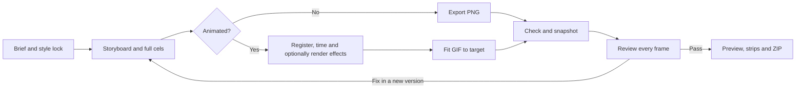

# Emoji Forge

An open-source agent skill for making custom emoji, stickers and reactions. Start with any character or style. Draw expressive key poses, register the cels, add optional GLSL effects, and check the final files at reaction size.


[Still preview](examples/demo/preview.png) · [Example ZIP](examples/demo/pack.zip) · [Example source](examples/build.py)

## Install the skill

Clone this repository as `emoji-forge` in your agent's skills directory. Keep the directory together so the skill can find its scripts and references.

| Agent | Directory for the checkout |
| --- | --- |
| Claude Code | `~/.claude/skills/emoji-forge` or `.claude/skills/emoji-forge` in a project. |
| Codex | `~/.agents/skills/emoji-forge` or `.agents/skills/emoji-forge` in a project. |
| Other agents | Use the client's [Agent Skills](https://agentskills.io/) location, or point the agent to [SKILL.md](SKILL.md). |

See the [Claude Code skill docs](https://code.claude.com/docs/en/skills) and [Codex skill docs](https://developers.openai.com/codex/skills/). Install [uv](https://docs.astral.sh/uv/) to run the tooling. Plain raster commands use Pillow. Add `--extra gpu` to the `uv run` commands for ModernGL. For fallback, add `--extra webgl` and use installed Chrome with `--channel chrome`, or install Chromium with `uv run --extra webgl playwright install chromium`.

## Five-command loop

From the checkout, scaffold the brief. Fill in the style sheet and storyboard, draw your cels, then reference them from the JSON manifest. Compare the two exports before choosing one for delivery.

```sh
uv run forge new my-emoji --preset slack
# Fill in my-emoji/style.md, storyboard.md, cels/ and pack.json.
uv run --extra gpu forge all my-emoji/pack.json build/draft --draft --jobs 2
uv run forge snapshot build/draft build/review
# Review every frame. Update source cels and timing before the final export.
uv run --extra gpu forge all my-emoji/pack.json build/final --jobs 2 --json
uv run forge compare build/draft build/final build/comparison
```

The final folder contains the named uploads, checks, timestamped strips, GIF and PNG previews, and a ZIP. `all` builds emoji in parallel and caches each one by its inputs and render options. Reuse the manifest with a fresh output folder to skip unchanged work. Draft renders use a smaller canvas and a separate cache key. `--json` supplies artifact paths, file dimensions, frame counts, or structured check results. A failing check exits nonzero. See [commands and manifest fields](references/workflow.md).

## Pipeline



## Rebuild the example

```sh
uv run --extra gpu python examples/build.py build/example
uv run --extra gpu --extra test pytest -q
```

The original sprout drawings are tiny reproducible fixtures. The [workflow](SKILL.md) describes how to produce your own full cels from a style reference. [Slack](references/slack.md) is an optional target. The generic preset works with a 256 px canvas and can be extended with other profiles.

## Authors

- [Pablo Pazos](https://github.com/ppazosp)
- [Jorge Hermo](https://github.com/jorgehermo9) · [@jorgehermo9 on X](https://x.com/jorgehermo9)

[MIT license](LICENSE)
