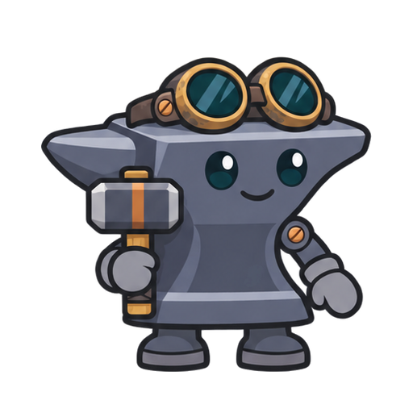
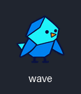
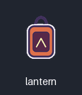

# Emoji Forge

<p align="center">
  
</p>

<p align="center">
  
</p>

Turn an idea, a mascot, or your own artwork into a custom emoji pack with your AI agent.

## What you can make

- Create still emoji, animated reactions, and stickers in your own style.
- Add GPU-rendered fire, glow, laser beams, glitches, or portals. Bring your own shader for a custom effect.
- Download Slack-ready files plus larger and smaller versions at 64, 128, 256, and 512 px.
- Share one preview of the whole pack and grab every emoji in a ZIP.

## Examples gallery

**Tavvik** — “Make a little anvil who forges emoji.” The pack above includes hammering, quenching, and shipping reactions. [Download the pack](examples/mascot/tavvik.zip) · [Model sheets, animatic, and lineup](examples/mascot/)

| Paper bird | Lantern |
| --- | --- |
|  |  |
| “Make a folded paper bird wave hello.” [Example](skills/emoji-forge/assets/threaded/) | “Make a lantern with a pulse of warm light.” [Shader example](skills/emoji-forge/assets/lantern/) |

See also the [Sprout reaction pack](examples/demo/).

## Install

```sh
npx skills add ppazosp/emoji-forge
```

Select your agent when prompted. Install uv so your agent can run the bundled tools. [Get uv](https://docs.astral.sh/uv/)

**Claude Code marketplace**

```
/plugin marketplace add ppazosp/emoji-forge
/plugin install emoji-forge@emoji-forge
```

**Manual copy.** Copy the full [skill directory](skills/emoji-forge/) into your project's `.agents/skills/` for Codex or Cursor, or `.claude/skills/` for Claude Code. [Setup details](skills/emoji-forge/references/setup.md)

## Usage

**Claude Code.** After installing with `npx skills add`, open a session in your project and try this prompt.

```text
/emoji-forge make 6 animated Slack emojis of our mascot: a blue robot with spring arms
```

For a one-shot run, enter `/emoji-forge make <idea>`. Your agent reviews the work and returns the finished GIF or PNG overview and ZIP. To see something along the way, add “show me the storyboard before animating” or `--checkpoints storyboard,keys` to your prompt.

If you installed through the marketplace, use `/emoji-forge:emoji-forge` in place of `/emoji-forge`. [Claude Code skills](https://code.claude.com/docs/en/skills)

**Codex CLI or IDE.** Type `$` and select `emoji-forge`, or enter `$emoji-forge` followed by your request. You can also find the skill through `/skills`. [Codex skills](https://learn.chatgpt.com/docs/build-skills#how-chatgpt-and-codex-use-skills)

**Cursor.** Type `/` in Agent chat and select `emoji-forge`, then add your request. [Cursor skills](https://cursor.com/docs/skills#how-skills-work)

**Any agent with the skill installed.** Ask in plain language.

> Use emoji-forge to turn this logo into a Slack emoji pack.

## Authors and license

[Pablo Pazos](https://github.com/ppazosp) and [Jorge Hermo](https://github.com/jorgehermo9) ([`@jorgehermo9` on X](https://x.com/jorgehermo9)). [MIT license](LICENSE)
