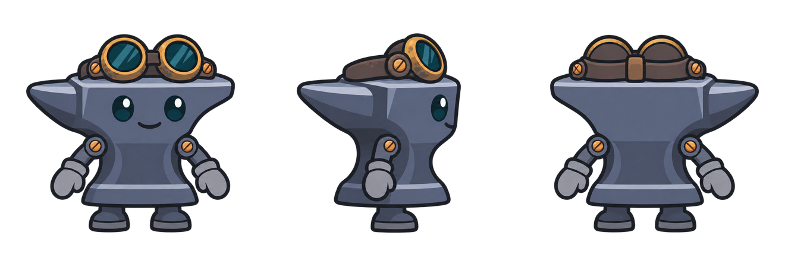
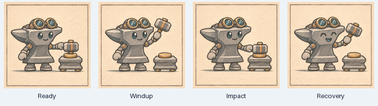
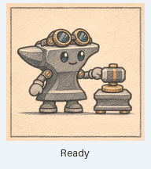

# Tavvik

Tavvik is a living steel anvil with soot-smudged brass goggles, articulated mittens and one copper-banded hammer. Six reactions show life in the workshop. The still uses the same hammer as the hammering animation.

[Animated overview](tavvik/overview@2x.gif) · [Download the pack](tavvik.zip) · [128 px uploads](tavvik/emoji/128/) · [Cross-pack lineup](lineup.png) · [Frame-by-frame hammer grip](emojis/hammering/strips/grip.png)

## Made with Emoji Forge

| Model | Storyboard | Animatic |
| --- | --- | --- |
|  |  |  |

- **Before drawing cels.** The [character bible](style.md) records the name and resemblance review. Model and integration sheets cover [all 13 assets](assets.json), including the [hammer views](images/assets/hammer/model.md), [hammer grip and contact](images/assets/hammer/integration.md), and separate [impact](images/assets/impact/model.md), [steam](images/assets/steam/model.md) and [bulb](images/assets/bulb/model.md) studies.
- **Drawing and timing.** [Boards](emojis/hammering/storyboard.md), [exposures](emojis/hammering/x-sheet.json), [threaded edit plan](emojis/hammering/plan.json), and [native image prompts](native-prompts.json) show how the cels were made. Hammering has two strikes in 3.6 seconds. The last drawing repeats the opening pose for the loop, and short exposures let the GPU sparks travel while the impact pose holds.
- **Three reviews.** Read the [asset review](review/asset.md), [integration review](review/integration.md), and [pack consistency review](review/consistency.md), or open the [stage records](production.json). The [scale check](scale-check.json) measures body height and centroid against the same model mask.
- **Final exports.** Every animated reaction is a GIF and the logo is a PNG at 64, 128, 256 and 512 px. The larger variants come from the 512 px masters. [Names and usage](tavvik/NAMES.md) · [Social preview](branding/social-preview.png)

The 1200 px GIF in the README also serves as the release overview. It uses the 256 px files at native size. The transparent release logo and 1280×640 social card use the 512 px masters. Run the following from the checkout root to rebuild the release files.

```sh
uv run --project skills/emoji-forge forge report examples/mascot/result/pack.json build/tavvik --scales 64,128,256,512
uv run --project skills/emoji-forge python tools/build_tavvik_previews.py --pack build/tavvik --brand build/brand
```

The hammering cels use the front view from the hammer sheet as one rigid layer. The shoulder carries the elbow, the elbow carries the wrist, and the wrist rotates the tool about one point inside the wrap. The mitten covers that point in every pose. Rebuild the cels and their full-tool masks with `python examples/mascot/emojis/hammering/rig/compose.py` using Pillow, then render the shot with its existing timing and effect files. Run `forge check examples/mascot/scale-manifest.json` to check the prop measurements for every exposure.
