# Shader gallery

The same Tavvik sticker with 40 GPU effects. Every GIF is 128×128 and rendered from 512×512 frames. The [neutral test gallery](../../docs/shader-gallery/) uses the same effects on a simple cel. Click a name to see the GLSL.

[32 px on dark](dark-32.png) · [32 px on light](light-32.png) · [Motion review](REVIEW.md) · [Write your own effect](../../skills/emoji-forge/references/shaders.md)

## Fire and energy

| [fire](../../skills/emoji-forge/shaders/fire.frag) | [plasma](../../skills/emoji-forge/shaders/plasma.frag) | [lightning](../../skills/emoji-forge/shaders/lightning.frag) |
| --- | --- | --- |
| 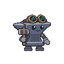 | 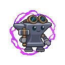 |  |

| [aura](../../skills/emoji-forge/shaders/aura.frag) | [portal](../../skills/emoji-forge/shaders/portal.frag) |
| --- | --- |
|  |  |

## Lighting

| [bloom-glow](../../skills/emoji-forge/shaders/bloom-glow.frag) | [god-rays](../../skills/emoji-forge/shaders/god-rays.frag) | [lens-flare](../../skills/emoji-forge/shaders/lens-flare.frag) |
| --- | --- | --- |
|  | 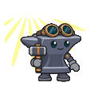 | 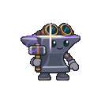 |

| [neon-rim](../../skills/emoji-forge/shaders/neon-rim.frag) | [shine](../../skills/emoji-forge/shaders/shine.frag) | [sparkle](../../skills/emoji-forge/shaders/sparkle.frag) |
| --- | --- | --- |
| 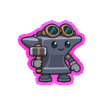 |  |  |

## Impact and movement

| [shockwave](../../skills/emoji-forge/shaders/shockwave.frag) | [speed-lines](../../skills/emoji-forge/shaders/speed-lines.frag) | [motion-smear](../../skills/emoji-forge/shaders/motion-smear.frag) |
| --- | --- | --- |
|  |  |  |

| [camera-shake](../../skills/emoji-forge/shaders/camera-shake.frag) | [dust](../../skills/emoji-forge/shaders/dust.frag) | [confetti](../../skills/emoji-forge/shaders/confetti.frag) |
| --- | --- | --- |
|  |  | 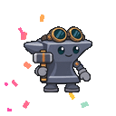 |

## Weather and liquids

| [splash](../../skills/emoji-forge/shaders/splash.frag) | [steam](../../skills/emoji-forge/shaders/steam.frag) | [smoke](../../skills/emoji-forge/shaders/smoke.frag) |
| --- | --- | --- |
|  | 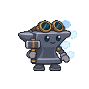 | 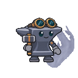 |

| [snow](../../skills/emoji-forge/shaders/snow.frag) | [rain](../../skills/emoji-forge/shaders/rain.frag) | [bubbles](../../skills/emoji-forge/shaders/bubbles.frag) |
| --- | --- | --- |
| 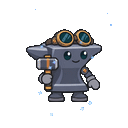 | 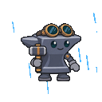 | 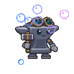 |

## Distortion and display

| [heat-haze](../../skills/emoji-forge/shaders/heat-haze.frag) | [glitch](../../skills/emoji-forge/shaders/glitch.frag) | [pixel-sort](../../skills/emoji-forge/shaders/pixel-sort.frag) |
| --- | --- | --- |
|  |  |  |

| [crt](../../skills/emoji-forge/shaders/crt.frag) | [black-hole](../../skills/emoji-forge/shaders/black-hole.frag) | [hologram](../../skills/emoji-forge/shaders/hologram.frag) |
| --- | --- | --- |
| 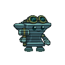 |  | 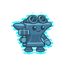 |

## Transitions

| [dissolve](../../skills/emoji-forge/shaders/dissolve.frag) | [shatter](../../skills/emoji-forge/shaders/shatter.frag) | [iris](../../skills/emoji-forge/shaders/iris.frag) |
| --- | --- | --- |
|  |  |  |

## Depth and perspective

| [beam-burn](../../skills/emoji-forge/shaders/beam-burn.frag) | [beam-perspective](../../skills/emoji-forge/shaders/beam-perspective.frag) | [parallax](../../skills/emoji-forge/shaders/parallax.frag) |
| --- | --- | --- |
|  |  | 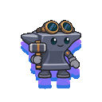 |

| [orbit](../../skills/emoji-forge/shaders/orbit.frag) |
| --- |
| 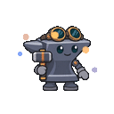 |

## Graphic treatments

| [halftone](../../skills/emoji-forge/shaders/halftone.frag) | [toon-outline](../../skills/emoji-forge/shaders/toon-outline.frag) | [ink](../../skills/emoji-forge/shaders/ink.frag) |
| --- | --- | --- |
| 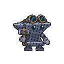 | 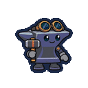 | 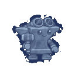 |

| [dither](../../skills/emoji-forge/shaders/dither.frag) |
| --- |
| 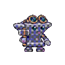 |
