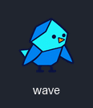

# A threaded paper bird wave

The [model](style.md), [expression sheet](expressions.md), [pose sheet](poses.md), [asset list](assets.json), [storyboard](emojis/wave/storyboard.md) and [X-sheet](emojis/wave/x-sheet.json) describe one greeting. The [animatic](review/wave/sheets/animatic.gif) shows the exposure timing. This compact example reuses the available art as its thumbnail panels. The [prompt log](emojis/wave/PROMPTS.md) records which edits produced the four shipped PNGs.

Copy this folder for a review run. Create `work/` first. From the installed skill directory:

```sh
cp -R assets/threaded work/bird
uv run forge plan work/bird/emojis/wave/storyboard.json work/bird/emojis/wave/plan.json \
  --x-sheet work/bird/emojis/wave/x-sheet.json
uv run forge sheets --project work/bird
# The native tool's four generated PNGs are already in emojis/wave/raw.
uv run forge import work/bird/emojis/wave/raw work/bird/emojis/wave/cels --scale shared \
  --timing-spec work/bird/emojis/wave/plan.json
uv run forge drift work/bird/emojis/wave/cels work/bird/images/model work/bird/emojis/wave/drift.json
uv run forge all work/bird/export.json work/bird/result
```

The [export manifest](export.json) assigns the normalized images to the Slack target. It uses the timing from the storyboard. The shipped image files make the example and tests runnable without an image provider.

[Six-stage review notes](REVIEW.md)


